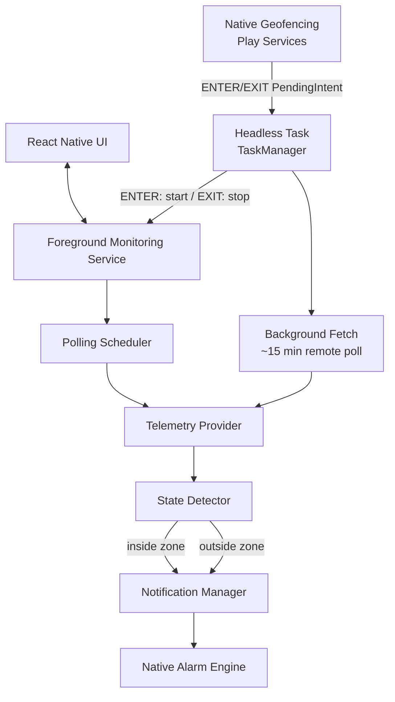

# SolarGuard Telemetry Monitoring Engine

This document describes SolarGuard's telemetry monitoring architecture, built around an Android Foreground Service with location-aware (geofenced) lifecycle management.

## Monitoring Modes

SolarGuard supports two monitoring modes, selected in **Settings → Location & Monitoring**:

| Mode | Foreground service | Sirens | Detection |
|---|---|---|---|
| **Always** (legacy default) | Runs continuously (`dataSync` type) | Everywhere | 5-min FGS polling |
| **Geofenced** | Runs only inside the configured home zone (`location` type) | Inside the zone only; outside → notification-only alerts | Inside: FGS polling · Outside: ~15-min background-fetch |

Geofenced mode degrades automatically to Always when: no home zone is configured, background location permission is missing, or fence registration fails.

## System Architecture

### Component Details

1. **React Native UI (`App.tsx` & Screens)**
   - Configures system preferences (refresh intervals, alarm sounds, battery thresholds, home zone + radius).
   - Dashboard shows a zone chip (Inside/Outside home zone) and location-aware outage banners.
   - Developer Options unlock mock telemetry, scheduled power cut/on events, a **Geofence Simulator** (ENTER/EXIT buttons + mock device position), and a monitoring-engine diagnostics panel (mode, dataSync budget, fence latency).

2. **Foreground Monitoring Service (`services/foregroundService.ts`)**
   - The single source of truth for telemetry monitoring while active.
   - Registered via `@notifee/react-native` as a native Android foreground service.
   - FGS type is mode-aware: `location` in geofenced mode (no OS time cap), `dataSync` in always mode. The manifest (`plugins/withAndroidForegroundService.js`) declares `dataSync|location`.
   - **Per-cycle geofence guard:** if the store says outside, runs one remote-mode poll then stops (stale run / missed EXIT).
   - **Missed-EXIT self-healing:** each cycle verifies real device position; two consecutive outside samples correct the fence state and stop the FGS (anti-flap hysteresis — one bad GPS fix never kills monitoring).
   - **dataSync budget guard (Android 15+, dataSync-typed runs):** tracks FGS runtime in a rolling 24h window; when the self-imposed 5.5h limit is reached, degrades to remote polling (notification-only alarms) and stops the service rather than letting the OS kill it. Applies to always mode and the geofenced-without-zone / fence-arm-failure fallbacks; the FGS type is resolved from settings at every notification update so it never flips mid-run.

3. **Geofence lifecycle (`services/geofenceService.ts`, `services/geofenceTasks.ts`)**
   - `expo-location.startGeofencingAsync` arms a circular fence (100–2000 m radius) in Play Services; monitoring happens in Google's process — zero app battery cost while armed.
   - ENTER/EXIT transitions arrive as headless `TaskManager` tasks, **even when the app process was killed** — Android spins up the process and boots a headless JS context (15 s execution budget).
   - ENTER → start monitoring FGS (siren-capable). EXIT → final remote poll → stop FGS.
   - Transition latency (task entry → FGS started) is measured and surfaced in diagnostics.

4. **Remote polling (`services/remotePolling.ts`)**
   - `expo-background-fetch` periodic task (~15 min, best-effort, Doze-deferrable).
   - Runs the full detection pipeline with remote context while outside the zone (or while a dataSync-typed run — always mode or its fallback shapes — is budget-degraded): grid transitions are still detected and recorded; only the audible siren is suppressed.
   - Registered with `stopOnTerminate: false, startOnBoot: true`.

5. **Telemetry Provider (`api/solar.ts`)**
   - Fetches live data from the SolarOS REST API, auto-refreshes OAuth tokens.
   - `AUTH_REQUIRED` pauses loops and surfaces "Login Required" states.

6. **State Detector (`services/stateDetector.ts`)**
   - Diffs `gridRelayStatus` against the persisted last-known status (AsyncStorage — readable while the device is locked).
   - `on → off`: records the outage in history; `off → on`: computes duration + SoC drop. Both run regardless of location.
   - Applies `DetectContext.remote` to all alert calls.

7. **Siren gate (`services/notifications.ts`)**
   - `AlertContext.remote` decides the alert's channel and whether `OutageAlarm` may trigger: remote (outside zone) alerts route to standard notification channels with system sound only.
   - Unknown fence state **fails loud** (siren plays) — location is never allowed to silently suppress an alarm.

8. **Alarm Engine (`modules/outage-alarm`)**
   - Native Android module: `OutageAlarmService` plays looping sirens via MediaPlayer (`USAGE_ALARM`) with a partial wakelock, auto-stop, and a 60 s cooldown.
   - Started via `startForegroundService()` + immediate `startForeground()` (mediaPlayback type) so it works from any context, including geofence headless tasks.
   - Also exposes `isIgnoringBatteryOptimizations()` and `getBootId()` (boot identity for fence-state staleness detection).

## Service Lifespan & Recovery

- **Device reboot:** Android wipes geofence registrations, but `expo-task-manager`'s `TaskBroadcastReceiver` (manifest-declared for `BOOT_COMPLETED`/`MY_PACKAGE_REPLACED`) restores persisted tasks natively — the fence re-arms without the app being opened. Fence state (`inside` flag) is validated against a persisted boot marker and reset to unknown (fail-loud) on next app open. The background-fetch task (`startOnBoot: true`) resumes remote polling.
- **App force close (swipe away):** geofence + background-fetch registrations survive (they live in Play Services / JobScheduler); ENTER wakes the process and headless JS restarts monitoring. Force-stop from App Info is a platform-enforced kill — nothing runs until the next manual launch.
- **Connection loss:** the FGS stays alive in a `Retrying` state, retrying every 60 s (5 min for auth errors).
- **dataSync timeout (Android 15+, always mode):** self-enforced budget degradation — see component 2.

## Battery Profile

- **Geofenced mode, outside zone:** no FGS, no JS runtime; native fence (~negligible) + periodic background-fetch only.
- **Geofenced mode, inside zone:** identical to legacy monitoring, but only for the at-home window.
- **Always mode:** unchanged from previous releases, modulo the Android 15+ budget cap.
